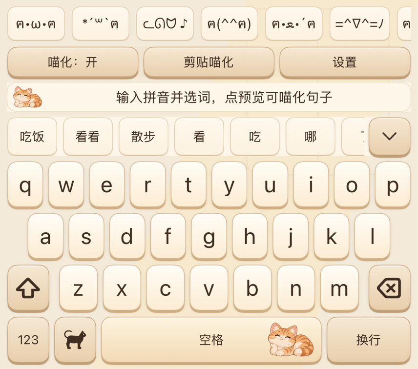
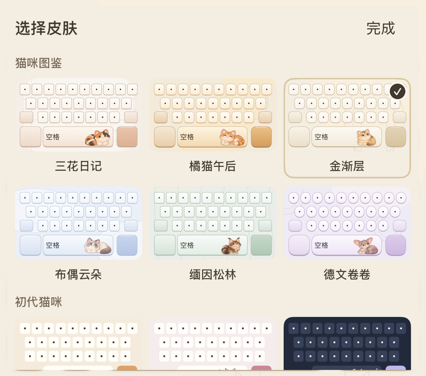

# MeowKeyboard

A Swift-based Chinese keyboard for iOS.

MeowKeyboard is a commercial iOS keyboard project built around Pinyin, T9 input, local personalization, Keyboard Extension integration, and StoreKit 2 entitlement handling.

<p>
  
  
</p>

November 7 development-source renders from an isolated iOS simulator harness using the real UIKit keyboard components. These captures use a fake text host; they are not phone touch or current App Store screenshots. [Capture scope](docs/ASSET_MANIFEST.md).

## Features

- Full Pinyin, Jianpin, mixed Pinyin, and T9 input
- Candidate ranking, continuous word selection, and composition recovery
- Local user lexicon and offline-first input
- Kaomoji, keyboard themes, and Chinese chat-oriented interactions
- StoreKit 2 membership entitlement handling

## Architecture

The production architecture separates the main app, Keyboard Extension, input engine, local persistence, App Group state, and StoreKit entitlement boundary. See [ARCHITECTURE.md](ARCHITECTURE.md). It describes the product architecture without exposing private implementation details.

## Chinese Input Engine

The public description covers retrieval, segmentation, composition, local learning, mixed Pinyin, and T9 design trade-offs. It intentionally omits production ranking formulas, weights, search parameters, and lexical resources. See [INPUT_ENGINE.md](INPUT_ENGINE.md).

## Keyboard Extension

The production extension uses `UIInputViewController` and `textDocumentProxy`, manages composition and candidate state, supports continuous selection and deletion recovery, and preserves the system globe switcher and long-press cursor control. Its complete source remains private.

## Run the Public Examples

This repository includes independent, invented-data Swift examples rather than production code:

```sh
swift test
```

The pure Swift examples cover composition state, candidate selection, deterministic deduplication, and entitlement-state boundaries. UIKit code is isolated behind `canImport(UIKit)` and needs an iOS SDK build separately.

## StoreKit 2

Purchases and verification belong to the main app; the keyboard extension reads a locally shared entitlement snapshot and does not start purchases. The public example uses a non-production identifier and does not represent an Apple-verified transaction. See [STOREKIT.md](STOREKIT.md).

## Testing

Production records and public-example validation are intentionally separated. Historical evaluations are not a new validation of the public package or a current release. See [TESTING.md](TESTING.md).

The November 3 build 61 checkpoint adds candidate-touch stability and bounded spelling recovery. The fixed 819-case Pinyin and 277-case T9 evaluations retained their previous ranking scores. A separate daily-input validation set exposes substantial remaining weaknesses in long Jianpin, mixed Pinyin, and typo recovery. [Development notes](docs/DEVELOPMENT_UPDATE_2026-11-03.md) describe the changes and their validation scope.

The November 7 source changes restore next-word suggestions after text boundaries, prevent duplicate learned suggestions from consuming result slots, and preserve candidate interaction during redundant host callbacks. Fixed Pinyin/T9 ranking scores remain unchanged. Six compatible native-material cat themes are integrated in source. Isolated UIKit checks cover layouts and stable hit bounds; selected frames were visually reviewed. Full device input and performance acceptance remain separate. [Current development scope](docs/DEVELOPMENT_UPDATE_2026-11-07.md) separates engine checks, isolated UIKit integration and pending device acceptance.

## Engineering Challenges

- Keeping raw input and displayed Pinyin separate so literal submission preserves user-entered casing and spacing.
- Binding candidates to consumption ranges and revisions to avoid stale asynchronous commits.
- Maintaining a local personalization boundary without uploading input content.
- Respecting the app/extension process boundary while propagating verified membership state.
- Providing an offline-tolerant entitlement snapshot without treating it as permanent purchase proof.
- Recovering mistyped but valid Pinyin without replacing intended input: local repair candidates improve some Top-5 results, while Mac measurements still show additional computation and typing-load performance on the phone remains unmeasured.

## App Store

As rechecked through Apple’s public storefront lookup on 2026-10-29, version 2.6 is listed on the [US App Store](https://apps.apple.com/us/app/id6813336672) and the [China mainland App Store](https://apps.apple.com/cn/app/id6813336672). This confirms public listing visibility in those two storefronts; an on-device download transaction was not tested. As verified in App Store Connect on 2026-10-27, version 2.6 remains Ready for Distribution and the 2.6.1 draft still selects build 58. Local development build 59 is separate and has not been uploaded. No new review submission or release was performed. See [APP_STORE_SHIPPING.md](APP_STORE_SHIPPING.md) for the scoped shipping record.

The latest November 3 changes are part of local development build 61. Selected visible-key input checks passed in the actual simulator system extension. A local StoreKit UI purchase completed; the final automated StoreKit lifecycle suite still has unresolved failures. A separate November 4 device record confirms build 61 installation and main-app launch. This does not establish software-keyboard touch acceptance or end-to-end phone performance. App Store Connect was not checked during this development checkpoint. The historical shipping record covers earlier development builds and the App Store draft separately. See [APP_STORE_SHIPPING.md](APP_STORE_SHIPPING.md).

Local development build 62 was fully archived and installed on the development phone on November 7. Signed main-app/extension bundles and packaged resources were checked. Installation is separate from keyboard touch acceptance; the device was locked when main-app launch was attempted. No App Store upload or review submission was performed.

## Repository Scope

This public repository contains selected implementation examples, architecture documentation, testing methodology, and product screenshots.

This repository does not distribute the complete production implementation, dictionary collection, ranking resources or App Store configuration. Third-party materials and their licensed derivatives retain their applicable license rights; omission from this repository does not override those terms.

© 2026 Milkyway42. Selected examples and documentation are provided for reference. Production source code and commercial assets are not open-sourced. All rights reserved unless otherwise noted.
