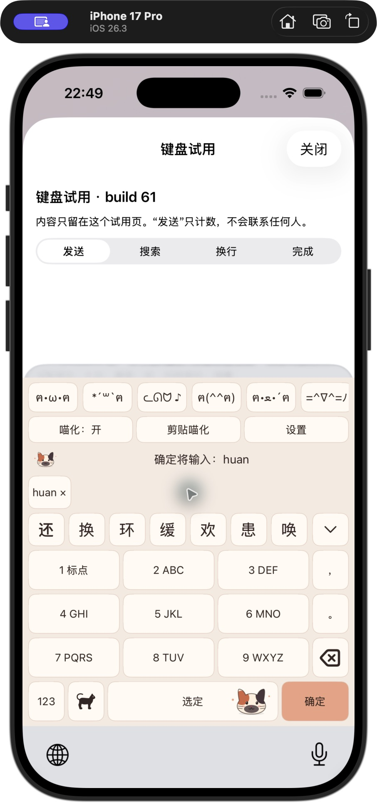
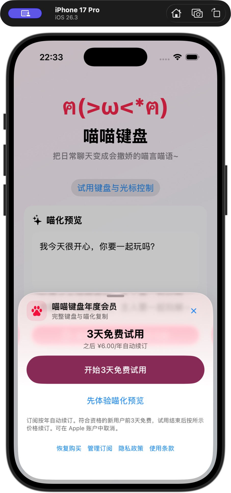

# November 3 development update

The build 60 baseline and its build 61 follow-up focus on the typing experience. Build 61 is the latest local checkpoint described below.

- Space remains available when results for the same composition arrive during a tap. The keyboard still checks the composition and host document before committing text.
- The first candidate row does less work per keystroke, and one-edit spelling repair reuses an index across queries. Both paths preserve the existing matching and ranking rules.
- Six original cat illustrations and palettes cover calico, orange tabby, golden shaded, ragdoll, Maine Coon, and Devon Rex. The keyboard renders illustrations on demand at a fixed size. Existing theme selections continue to resolve.
- The membership entry sizes to its content, supports a larger accessible layout, and keeps pricing, renewal terms, and restoration close to the purchase action. A purchase tap still opens Apple's payment confirmation.

The Pinyin regression set (819 cases) scored 48.72% / 60.07% / 63.98% at Top-1 / Top-3 / Top-5. The T9 set (277 cases) scored 62.09% / 76.17% / 79.78%. These scores describe the fixed synthetic sets. Ranking and typo recovery remain priorities.

The build 60 automated production assertion suite and iOS source type checks passed. Its first command-line package build was blocked by the asset compiler losing its CoreSimulator connection. A later Xcode graphical build restored simulator execution for the follow-up below. Phone performance remains unmeasured for these development changes.

Engineering references include the [Rime script translator](https://github.com/rime/librime/blob/master/src/rime/gear/script_translator.cc) and [LibIME Pinyin context](https://github.com/fcitx/libime/blob/master/src/libime/pinyin/pinyincontext.cpp). Their segmentation and matching designs informed the review. The production implementation and artwork are maintained separately.

## Build 61 follow-up

Local build 61 builds on the earlier theme and membership work. Candidate presentation now retains a touched candidate and its consumption range while a gesture is active. A final asynchronous update waits until the interaction finishes and rechecks the current composition and host before presentation. A completed worker result can also be reused if Space is pressed before its presentation callback runs. An unfinished result can still require synchronous resolution, so the full latency issue remains open.

Deterministic state replays cover overlapping touches, result replacement, invalidation and concurrent result handoff. They exercise production state types. Selected system-extension interactions have since been exercised in the simulator as recorded below. The full gesture matrix and phone frame timings remain unverified. DEBUG performance markers contain no typed text or host content. Marker placement alone is not a latency measurement.

A bounded spelling-recovery change allows nearby token boundaries to compete and prevents a qualifying repair from being lost merely because the same text already appears farther down the list. The original input remains represented. On the existing 106-case synthetic typo set, Top-1 and Top-3 both remained 17.92%, while Top-5 moved from 37.74% to 41.51%. Five targets entered Top-5 and one fell out. Omission errors remained weak at 6/26 Top-5. On a separate 162-case diagnostic set, Top-5 changed from 59.26% to 59.88%. These observed sets are development evidence, not fresh blind tests.

The complete fixed regression totals remain unchanged. Their categories reveal the remaining gap more clearly than the aggregate.

| Fixed category | Cases | Top-1 | Top-3 | Top-5 |
|---|---:|---:|---:|---:|
| Pinyin, all forms | 819 | 48.72% | 60.07% | 63.98% |
| T9 | 277 | 62.09% | 76.17% | 79.78% |

Within the 819 cases, complete-target Top-5 is 249/277 for full Pinyin, 95/273 for Jianpin, and 180/269 for mixed Pinyin. In Jianpin, 145 targets are absent from the returned complete-target list and 33 appear below fifth place. Absence of a whole phrase in a dictionary does not establish that its component words are unavailable. Retrieval, search and ranking still need separate diagnosis.

An independently authored 66-case set was frozen before its first candidate observation. It includes paired input representations, so its 66 records are not statistically independent user tasks. After the first comparison it became an observed regression set. The evaluated build 61 engine checkpoint retained the baseline category results, including full Pinyin 10/12, long Jianpin 0/12, mixed Pinyin 6/12, legal-syllable errors 2/8 and T9 6/8 at Top-5. The mixed-text and URL checks exercise only the engine API and do not establish host-level behavior.

A bounded target-prefix selection simulation could complete all twelve long-Jianpin tasks through repeated choices despite none appearing as a complete Top-5 target. The simulation is evidence of interaction cost, with an assumed five slots per page. It is not a measured touch, scrolling, correction or retyping trace. Its operation counts were not rerun for the subsequent build 61 candidate.

Mac measurements do not establish a phone-speed improvement. A single paired 106-case process CPU measurement changed from 7.59 to 7.75 seconds. Other single-pass wall-clock percentiles were noisy. Full system-extension startup, touch-to-visible-feedback, final-candidate latency, skin comparison and typing-load memory still require device measurement. The project has not established parity with Apple's, Sogou's or WeChat's keyboard.

### Component evaluation

Rime's core uses BSD-3-Clause, while LibIME's inspected Pinyin implementation uses LGPL-2.1-or-later. Dictionary and model rights require their own review. KeyboardKit's current license requires a valid license key and a written agreement. This checkpoint imports no implementation or resource from these projects. The review informs the project's own design and future integration decisions. [Rime license](https://github.com/rime/librime/blob/master/LICENSE), [LibIME Pinyin source](https://github.com/fcitx/libime/blob/master/src/libime/pinyin/pinyincontext.cpp), [KeyboardKit license](https://github.com/KeyboardKit/KeyboardKit/blob/master/LICENSE).

### Direct-reading candidate order

Actual extension inspection exposed a separate candidate-order problem. For a complete single syllable, incidental combinations of shorter syllables could appear ahead of ordinary characters with that exact reading. The change prioritizes supported direct readings while preserving dictionary-backed words and initialisms. For `huan`, 唤、桓、浣 now occupy positions 7–9 and the incidental 胡按 combination moves farther down. Explicit syllable boundaries still distinguish `hu'an`, and established expressions under ambiguous inputs remain represented.

A paired audit of 1,233 spelling/context queries retained the same candidate text, consumption ranges and kinds while changing their order where relevant. The existing 8,454 character–reading inventory remains reachable in full Pinyin, T9 and explicit-reading T9. This inventory checks access to readings and is not a measure of daily-message accuracy. The fixed 819/277 totals remain unchanged after this ordering change. It reduces unnecessary candidate searching for a class of direct readings without resolving the broader long-Jianpin and sentence-ranking weaknesses.

### Simulator integration checks

The actual system keyboard extension was exercised through its visible keys in an iPhone 17 Pro simulator running iOS 26.3. The test host recorded input and action counters. This run confirmed the first candidate 还 for `huan`, the first candidate 还款 for `huankuan`, expanded-candidate selection committing 还, and T9 `4826` followed by the explicit `huan` reading producing 还. A held Delete stopped on release and subsequent input remained possible.

With a composition present, the first Confirm tap committed the original text and left the host action counter at zero. A second independent tap incremented it to one. These are simulator integration observations of the extension, separate from direct engine calls and the pure state replays.

On the same simulator and host, Apple's Chinese 26-key keyboard returned 换、还、环、患、欢、缓、幻、焕、唤 for the single `huan` comparison. Learning histories were not reset. This one sample documents candidate availability and order only and supports no broader competitive claim.

A local Xcode StoreKit UI purchase completed, the main app restart did not repeat the entry for the entitled user, and the extension unlocked. The final integration XCTest run executed two cases and both failed: local transaction bootstrap returned `notEntitled` before the guarded purchase call, and the startup assertion lacked clean isolation from the earlier test purchase. An earlier product-load failure/retry run passed, but this does not establish a passing final suite. Pure entitlement and startup-state assertions passed separately. No real-money payment was performed; the full purchase/startup matrix remains incomplete.

The final build 61 source passed the complete production assertion suite and a full arm64 Release build of the main app, extension and resources. Both local development signatures verified. This is not an Archive or App Store distribution-validation result. Physical-device installation and phone performance are not established by the simulator run. No new App Store upload, review submission or release was performed.

### Current visual evidence

Six original cat themes were individually inspected in the actual extension’s portrait 26-key layout. T9, numeric symbols and candidate expansion were also displayed; a T9 landscape view was inspected. The full per-theme iPad/orientation/gesture matrix is still incomplete. An opt-in debug stress probe recorded 360 theme switches and preserved composition; it is not a phone typing-latency benchmark. The probe no longer runs merely because the user opens the theme picker.

 

These captures show the development environment. [Asset provenance and privacy checks](ASSET_MANIFEST.md).
